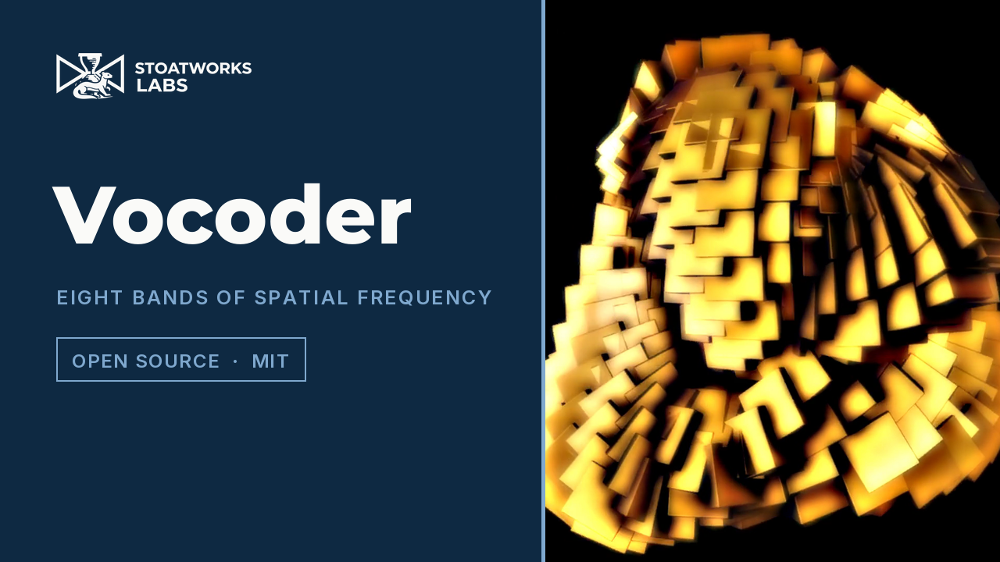
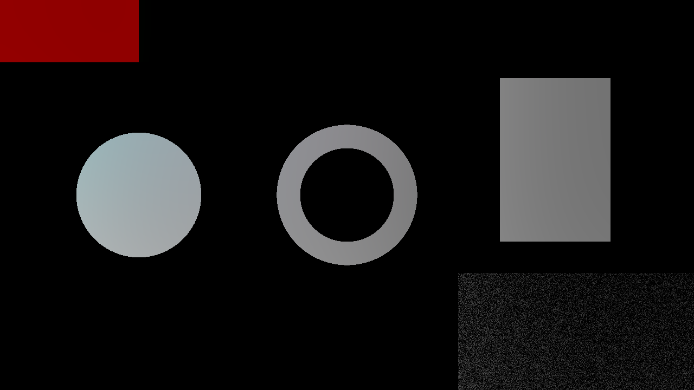

# Vocoder

> **AI-assisted project.** This codebase was created with [Claude](https://claude.com/claude-code)
> (Anthropic), directed and reviewed by a human author. It **has** been registered,
> loaded and instantiated in Resolume Arena 7.27.1 (on Windows, on a software rasteriser,
> with the shaders compiling), but it has **never run on a GPU in Resolume**, and it's never
> been instantiated in Arena on macOS. The main claim is numerical, so it's measured rather
> than just asserted, by an offline harness that drives the plugin class itself in a
> headless GL context: the pyramid reconstructs its input **to a maximum difference of 0**
> at 720p, 1080p and 4K on this Mac (and **within one float ULP** where the two sides of the
> cancellation round differently, as GitHub's macOS runner does), its bands partition the
> picture to 9.5e-07, and a sine in audio band *k* moves picture band *k* and no other. More
> under [Status](#status). Check it in your own rig before you trust it in a show.

A channel vocoder with the picture as the carrier, as an FFGL effect for
[Resolume](https://resolume.com) Arena and Avenue. With nothing routed to it, it's a
graphic EQ for spatial frequency; feed it audio and the bass pumps the big shapes while
the treble sparkles the fine detail. It won't make anyone sound like a robot, I'm afraid.
It does that sort of thing to pictures instead.

**[Try the EQ side in your browser](https://vocoder-demo.stoatworks-labs.com/)**: the
plugin's own shaders in WebGL2, with nothing to install. The audio side isn't there,
and it isn't faked either.

[](https://www.youtube.com/watch?v=lPsvlzdT41E)

*[Watch it](https://www.youtube.com/watch?v=lPsvlzdT41E) (52 seconds): one band
cut and put back, the same fader pushed to 4× until the picture rings, the tilt,
the residual at zero, and the null. It's all the plugin's own output. An FFGL
plugin doesn't have a window to film, so the footage comes from this repo's
offline harness (`vctest --pipe`, driven by a cue sheet) rather than a recording
of a screen, on Resolume's own bundled demo clips. The last beat is audio-driven,
and the spectrum driving it is the harness's synthetic programme (`--feed`)
rather than music.*

<!-- downloads:start -->

## Download

**[v0.1.0](https://github.com/stoatworks-labs/vocoder/releases/tag/v0.1.0)** — prebuilt for macOS and Windows. Pick your platform:

<details>
<summary><b>macOS</b> — Universal (Apple Silicon + Intel)</summary>

| Build | Download | Size |
| --- | --- | --- |
| Universal (Apple Silicon + Intel) · .dmg disk image | [`vocoder-0.1.0-macos-universal.dmg`](https://github.com/stoatworks-labs/vocoder/releases/download/v0.1.0/vocoder-0.1.0-macos-universal.dmg) | 218 KB |
| Universal (Apple Silicon + Intel) · .zip archive | [`vocoder-macos-universal.zip`](https://github.com/stoatworks-labs/vocoder/releases/latest/download/vocoder-macos-universal.zip) | 181 KB |

</details>

<details>
<summary><b>Windows</b> — x64</summary>

| Build | Download | Size |
| --- | --- | --- |
| x64 · .exe installer | [`vocoder-0.1.0-windows-x86_64-setup.exe`](https://github.com/stoatworks-labs/vocoder/releases/download/v0.1.0/vocoder-0.1.0-windows-x86_64-setup.exe) | 219 KB |
| x64 · .zip archive | [`vocoder-windows-x86_64.zip`](https://github.com/stoatworks-labs/vocoder/releases/latest/download/vocoder-windows-x86_64.zip) | 112 KB |

</details>

All builds, checksums and release notes: [github.com/stoatworks-labs/vocoder/releases](https://github.com/stoatworks-labs/vocoder/releases).

macOS builds are signed and notarised and open normally. The Windows builds are unsigned, so SmartScreen warns once.

<!-- downloads:end -->

## The one idea

A channel vocoder splits the **carrier** into frequency bands and sets each
band's gain from the matching band of the **modulator**. That's the whole
machine, and everything else is a choice of what to put in it.

So put a picture in it. The carrier is the frame, its "frequency" is **spatial**
frequency, and the modulator is the audio. Split the frame into a Laplacian
pyramid (eight octave bands, from one-pixel detail up to 128-pixel shapes, plus
a residual), multiply each band by a gain, and sum them back.

With every gain at 1× the input comes back **exactly**, not approximately:
the reconstruction is arranged so the thing being expanded is a difference
that's identically zero, so the output is the input to the bit. That's the
plugin's null, and it's what keeps everything else honest.

The exactness comes from the structure rather than luck, but it only holds to the
bit while both sides of that difference are computed the same way. They are on this
Mac, where the measurement is a literal zero. On GitHub's macOS runner, which
has no accelerated GL context, the same test reads 5.96e-08: one ULP of a float,
a rounding difference between the two paths rather than a reconstruction
error. The check allows that ULP and prints the number either way, so you can
still see the difference instead of it disappearing into a tolerance.

## What falls out of it



<sub>"Spectrum only": the Residual at 0, so the picture's DC and coarsest shapes
are removed and what's left is the picture as its detail bands. Rendered by
`vctest`, the offline harness, rather than captured from Resolume. The source card is
[docs/card.png](docs/card.png).</sub>

**A graphic EQ for spatial frequency**, when nothing is routed to it. A boost at
the 4 px band makes the picture *ring* at 4 px; a cut removes detail at that
scale and leaves every other scale alone; a tilt across the bank is sharpen at
one end and soften at the other. So it's nine independent faders across scale,
rather than one blur or sharpen knob.

**A vocoder**, when audio is routed. The eight audio bands drive the eight
picture bands: bass pumps the large shapes and treble sparkles the fine detail,
or the reverse by a switch. The audio gains *multiply* the slider gains, so a
band you've cut stays cut whatever the music does.

**A new kind of edge picture**, by turning the Residual down. What's left is
the picture as its detail bands, as in the image above.

## Controls

**EQ**: `Band 1 (1 px)` … `Band 8 (128 px)`, `Residual`, `Tilt`, `Master`,
`Carrier`.

The band sliders are **0 to 4×, linear, with 1× at a quarter**. That's unusual,
and on purpose: a graphic EQ's fader is symmetric in dB, but a vocoder band's
gain is a multiplier that spends most of its life between "off" and "as loud as
the carrier", so this gives the cut side a usable length and the boost side room
to ring. `Tilt` is ±6 dB per band about the middle of the bank. `Carrier` picks
RGB (all three channels) or Luma (Y only, keeping the input's colour).

A band's *name* is its level's sampling pitch. Its power actually peaks a little
lower (an octave band of a Burt–Adelson pyramid is centred well below its
level's Nyquist), so the "4 px" band rings with a period of about 21 px.
`vctest --band` measures that rather than assuming it, and the numbers are in
[Status](#status).

**Audio**: `Audio` (the source picker), `Drive`, `Floor`, `Attack`, `Release`,
`Mapping`, `Sidechain Mode`.

`Drive` is how far a fully driven band swings, 0–24 dB. `Floor` is what a
**silent** band does: at 0 quiet bands go dark, at 1 the audio only ever adds.
`Mapping` is Direct (low audio → coarse picture band) or Reverse. `Sidechain
Mode` is Vocoder (one envelope per band) or Dynamics (one envelope for the lot,
driving the Tilt).

**Output**: `Mix`.

## Status

**v0.1.0, and still early days.** Everything below is measured by
`tools/verify.sh` on an M4 Max, macOS 26.4, against a fresh universal Release
build.

| Check | Result |
| --- | --- |
| Reconstruction is exact | max difference **0** at 720p, 1080p and 4K, all gains at 1× |
| …through the Luma carrier | 5.96e-08 (a Y/Cb/Cr round trip on top) |
| The bands partition the picture | 9.54e-07 — the eight band-cuts sum to what the algebra says |
| Shipped shader vs CPU pyramid | **1.2e-07** worst, over all eight bands |
| Each band is where it should be | peaks at 2.0, 10.1, 21.5, 43.5, 87.3, 174.5, 347.0, 677.1 px — doubling, as an octave bank must |
| Audio band *k* → picture band *k* | 16 mapping cases exact; 10 of them re-checked through the picture against the equivalent slider, **max difference 0** |
| Envelope followers | attack and release within **0.0%** of the time constants, at three settings |
| No dead controls | all **19** swept parameters measurably change the picture (2 skipped, with reasons) |
| macOS binary | a local build is universal (`arm64 x86_64`), exports `plugMain`, and ad-hoc signs |
| As a host reads it | `oxbow probe`: **SW Vocoder**, `VC01`, effect, 24 parameters in 4 groups, none truncated |
| Render cost | 0.77 ms at 720p, 0.66 at 1080p, 1.89 at 4K |

The render cost isn't a typo: 1080p is *faster* than 720p. There are 33 passes
for eight levels and most of them are tiny, so at small sizes the per-pass
overhead dominates and the pixel count barely matters. At 4K it's 11% of a
60 fps frame.

### In Resolume, on Windows

On 2026-09-21 the plugin was put in front of a real host for the first time:
**Resolume Arena 7.27.1** (build 15990) on win-lab, an x64 Windows 11 Pro VM
with **no GPU**, so OpenGL came from **Mesa llvmpipe** (the plugin reported
`Mesa … llvmpipe (LLVM 22.1.8, 256 bits) … 4.5 (Core Profile) Mesa 26.2.0`
itself).

| Check | Result |
| --- | --- |
| Windows x64 DLL | cross-compiled in the Parallels guest on the Mac (ARM64 Windows 11, MSVC 2022 Build Tools, `cmake -A x64`, vcpkg `x64-windows-static-md`) — **372,736 bytes**, `dumpbin /EXPORTS` shows `plugMain` |
| Arena registers it | Arena's own REST API lists **SW Vocoder** among 112 video effects, under `idstring` `VC01`, with the description the plugin declares |
| Arena loads the DLL | the plugin wrote `plugin loaded build=<stamp>` to its diag log, with the stamp of the DLL built minutes earlier |
| Arena instantiates it, and the shaders compile | applied from Arena's own effects browser; logged the GL strings then `initialised`, and Arena drew its inspector, groups and all |
| Host clock unit, in a real host | logged `host clock unit decided: milliseconds` inside Arena, against seconds under oxbow — the first time that code has met a real host |
| Headless on x64 Windows | `oxbow selftest`: **120 frames, gl error 0x0, PASS**, 921,600/921,600 lit pixels (100%) |
| Warnings or errors | none — the diag log is clean of WARN/ERROR/FAIL |

**No GPU was involved**, so nothing here says anything about performance on
Windows and nothing was timed there; the ms/frame figures above are still
macOS-only.

**Not verified.** It's never been instantiated in Arena on macOS, and it's
never run on a GPU in Resolume on either platform. **No real audio reached it in
Arena**: the audio paths are still exercised only by the harness's synthetic
spectrum, because the host is the only thing that can fill an FFT buffer. So
what Resolume's 64 FFT bins actually *mean* is **still assumed rather than
measured**, and it's still the biggest open question in the repo.
[AGENTS.md](AGENTS.md) is where the assumption is written down. A long session,
a composition save/reload and preset recall in the host weren't tried either.
There's no user guide, no OpenFX port and no factory presets. There's a
[browser demo](https://vocoder-demo.stoatworks-labs.com/), which runs the plugin's
own shaders in WebGL2, but it only carries the EQ side and says so, because the
audio half can't be shown in a browser at all.

The DLL in the table above was the hand-built one. CI builds x64 Windows on every
push and the release workflow builds it again on a GitHub runner. Both have run
and passed, but neither of those builds has been put in front of Arena.

## Build

Needs CMake 3.15+, a C++17 compiler, and the FFGL SDK submodule.

```bash
git clone --recursive https://github.com/stoatworks-labs/vocoder
cd vocoder
cmake -B build -DCMAKE_BUILD_TYPE=Release
cmake --build build
cmake --install build    # → ~/Documents/Resolume Arena/Extra Effects
```

macOS builds universal (arm64 + x86_64) by default. Add
`-DCMAKE_OSX_ARCHITECTURES=arm64` for a faster development build.

## Building and testing

The offline harness renders the plugin class itself, headless:

```bash
./build/vctest --out /tmp/frame.png     # the test card, through the plugin
./build/vctest --list                   # every parameter and its default
./build/vctest --identity               # the reconstruction is exact
./build/vctest --band                   # each band, against the CPU pyramid
./build/vctest --audio                  # a sine in band k drives band k
./build/vctest --envelope               # the followers' time constants
./build/vctest --bench                  # 720p through 4K
python3 tools/sweep.py                  # no control is silently dead
tools/verify.sh                         # all of it, on a fresh universal build
```

`--pipe` puts raw RGBA frames from stdin through the plugin class itself and
writes raw RGBA to stdout, so a clip can be filmed through it:

```bash
ffmpeg -i in.mov -f rawvideo -pix_fmt rgba - \
  | ./build/vctest --pipe --width 1920 --height 1080 --script cues.txt \
  | ffmpeg -f rawvideo -pix_fmt rgba -s 1920x1080 -i - out.mov
```

A cue sheet is one `frame  Parameter Name  value` per line, held at the ends and
interpolated between.

`--feed L` writes a synthetic spectrum, without which the Audio group is
correctly dead offline.

<!-- attributions:start -->
This project is built on other people's work — see [ATTRIBUTIONS.md](ATTRIBUTIONS.md).
<!-- attributions:end -->

## Licence

MIT — see [LICENSE](LICENSE).

The Laplacian pyramid is Burt and Adelson's, from *The Laplacian Pyramid as a
Compact Image Code* (1983); the channel vocoder it stands in for is Homer
Dudley's (1939). Both come from the published literature rather than anyone's
source code, and the implementation here is this repo's own.
